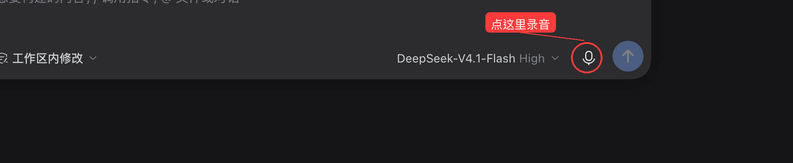

# dsh-plugin-voice-autosend

Voice input for the [DeepSeek Harness](https://github.com/deepseek-ai/deepseek-harness) composer.
Press the microphone, speak, and the transcript is **sent automatically** — no extra click, no editing
the draft first. Transcription runs **locally** on your machine with SenseVoice, so audio never leaves it.



## What it does

- **Speak instead of typing** — a microphone button sits between the model picker and the send button.
- **Auto-send** — when the recognizer returns text, it is inserted into the draft and submitted in the
  same tick, so the turn starts immediately. Empty or failed transcriptions never send anything.
- **Local, offline recognition** — [SenseVoiceSmall](https://huggingface.co/csukuangfj/sherpa-onnx-sense-voice-zh-en-ja-ko-yue-2024-07-17)
  INT8 via sherpa-onnx. Audio is transcribed on the host that runs DSH; nothing is uploaded.
- **Languages** — auto-detect, Chinese, English, Cantonese, Japanese, Korean, Spanish, French, German,
  Russian, Portuguese.
- **Long dictation** — records up to 120 s, with a live waveform and level meter; stop early with
  "Stop and transcribe".
- **Device and engine settings** — pick the input device and language on the plugin's own detail page.

## Requirements

- DeepSeek Harness with the experimental speech-to-text packages (bundled with the desktop app and the
  `@deepseek-ai/dsh` distribution; this plugin declares them as optional peers and inserts the needed
  rows itself).
- Microphone permission for the DSH host (macOS: *System Settings → Privacy & Security → Microphone*).
  Microphone capture needs a secure context — the desktop app and `http://127.0.0.1` both qualify.

## Install

From the plugin market once listed, or directly:

```bash
dsh plugin add github:ma1833577561/dsh-plugin-voice-autosend
# or, from npm
dsh plugin add dsh-plugin-voice-autosend
```

Then open **Plugins → voice-autosend** and press **Download and prepare** the first time; the
SenseVoice model (~242 MB) is fetched once into `~/.dsh/speech-to-text/sensevoice` and reused.

> If you previously enabled the built-in **Voice Input** plugin, turn it off first: both register the
> same speech provider, and two copies of the recognizer cannot coexist.

## Usage

1. Click the microphone next to the send button.
2. Speak. Click **Stop and transcribe** (or let it stop at 120 s).
3. The transcript is inserted and sent. Cancel any time with the ✕ button.

Language and input device live on the plugin detail page under **Plugins**.

## How it works

The bundle patch inserts the speech service, the SenseVoice provider and the speech API, then mounts a
client bundle derived from the official `@deepseek-ai/dsh-experimental-client-ui-voice-input`
(MIT). The only behavioural change is in `finish()`: after `inputActions.insertText(...)` succeeds it
calls `inputActions.submit()`, which starts the turn exactly like pressing Enter. If insertion is
rejected because the draft changed mid-transcription, the text is kept in the pending slot instead of
being sent — so a concurrent edit never gets overwritten.

## License

MIT. See [LICENSE](LICENSE) and [NOTICE](NOTICE) for the upstream attribution.

---

## 中文说明

在 DeepSeek Harness 的输入框里说话，转写完成后**自动发送**。语音识别在本机完成（SenseVoice），
音频不出本机，支持自动识别/中/英/粤/日/韩/西/法/德/俄/葡。

安装：`dsh plugin add github:ma1833577561/dsh-plugin-voice-autosend`，然后在「插件」里打开本插件，
首次使用点「下载并准备」拉取约 242 MB 模型（只需一次）。

注意：如果之前开过内置的「语音输入」插件，请先关掉它，否则两者会注册同一个识别服务。
